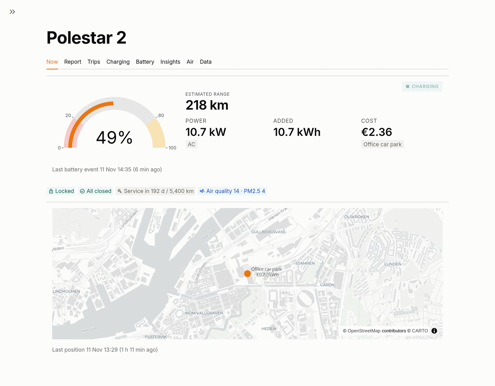
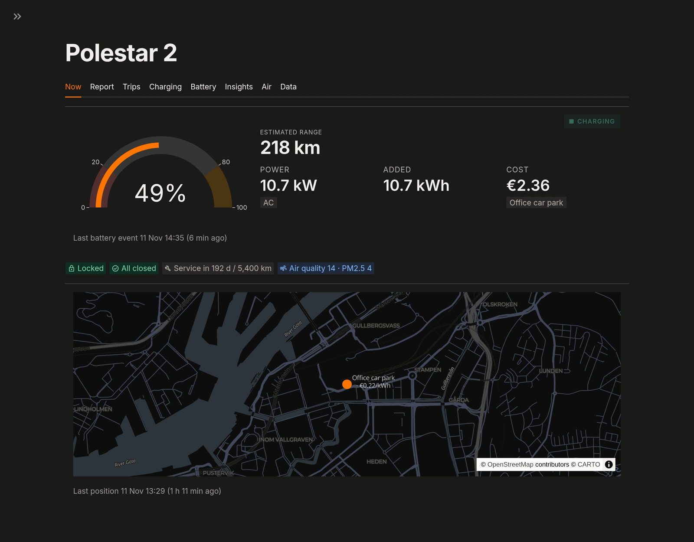
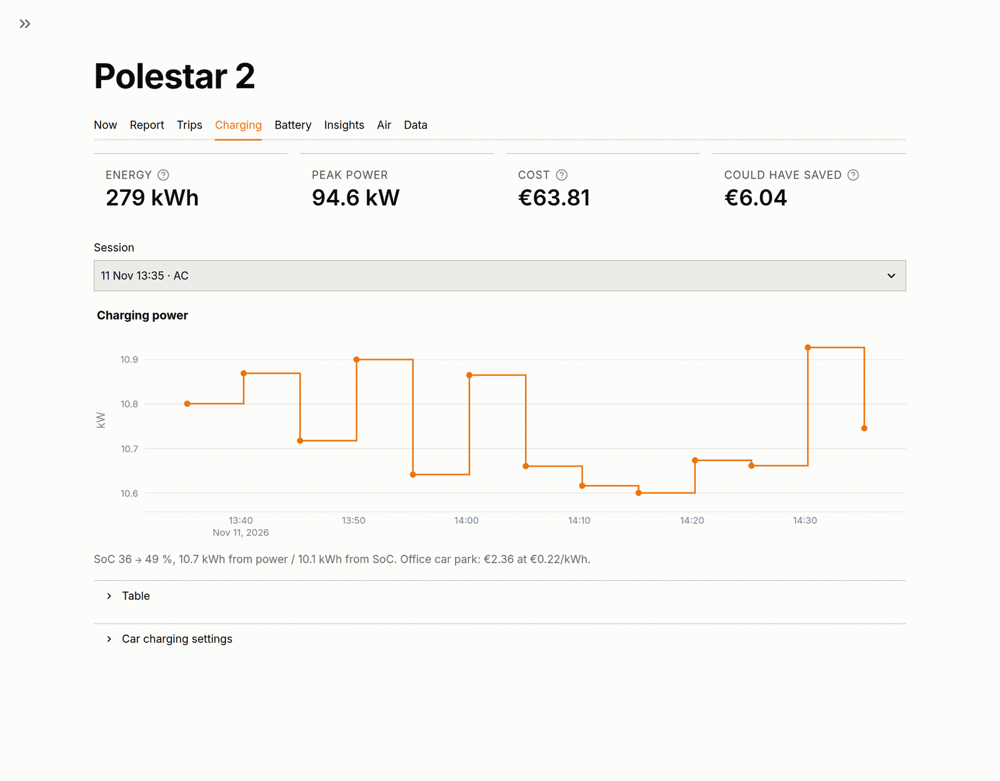
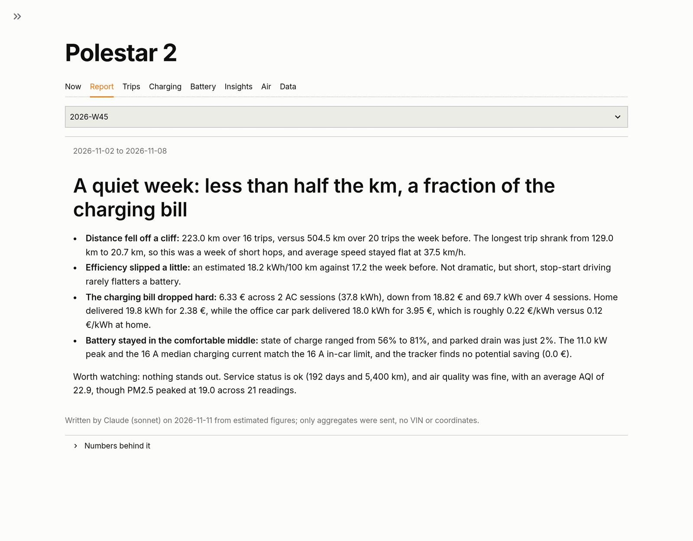
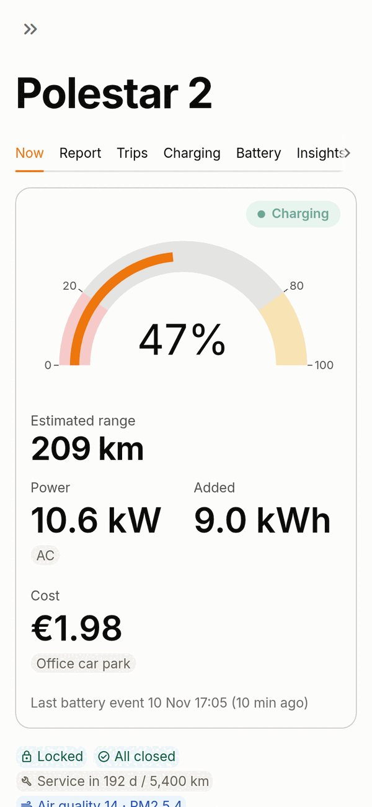
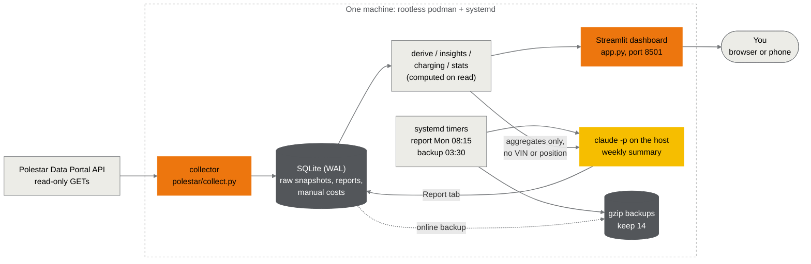

# Polestar telemetry

Collect, store and understand your Polestar 2 usage: trips, charging, battery, cabin air and a weekly written summary, in a small self-hosted dashboard.

**[Live demo](https://polestar.lafabrique.ai/)**: the real dashboard on a synthetic car and made-up places, with the clock frozen.

The [Polestar Data Portal API](api.json) only returns the **current state** of the car. It has no history and no trips. This app polls it, keeps every snapshot in SQLite, derives trips and charge sessions from those snapshots, and shows them in a Streamlit dashboard.

<p align="center"></p>

<p align="center">
  
  
</p>
<p align="center">
  
  
  
</p>

<sub>Screenshots use a synthetic car and made-up places (see [`demo/`](demo/)); the weekly report was written by the real `claude` CLI from those synthetic figures.</sub>

How it fits together. The report step runs on the host, not in a container, because the containers have no `claude` CLI.



Python 3.11 or newer (developed on 3.13), SQLite, Streamlit, Plotly. Runs on a laptop for development and in two containers (collector and dashboard) on a small server.

## Quick start

Needs a Linux or macOS machine with [mise](https://mise.jdx.dev), git and podman (or docker). Register for API access on the [Polestar Data Portal](https://data-portal.polestar.com/) first and note the Client ID, Client secret and Account ID ([how](docs/configuration.md#credentials-env-never-committed)).

### Deploy (copy and paste)

Replace the three placeholders, then run the block. It builds the two containers, waits until the dashboard is healthy and installs the weekly Claude report timer.

```sh
git clone https://github.com/coulof/polestar-telemetry.git && cd polestar-telemetry
cat > .env <<'EOF'
M2M_ENDPOINT=https://pc-api.polestar.com/eu-north-1/data-portal/m2m/token
APP_ID=<client id>
SECRET=<client secret>
ACCOUNT_ID=<account id>
EOF
chmod 600 .env
mise run deploy
```

Open <http://127.0.0.1:8501>. The first data appears after the first poll (up to 5 minutes).

- **No Claude subscription?** Run `mise run deploy:stack` instead: it skips the weekly report. Also set `[report] enabled = false` in `config.toml` to hide the Report tab.
- **Prices, locations, time zone:** edit the `config.toml` that deploy created from [`config.example.toml`](config.example.toml); changes apply without a restart.
- **Reach it from your phone or add a login:** see [Deployment](docs/deployment.md#access-and-the-login-page).

### Run from source (development)

```sh
mise run setup && mise run smoke    # install, then check credentials (prints field names only)
mise run watch                      # collect in a loop
mise run app                        # dashboard on http://localhost:8501
```

## Documentation

| Page | Covers |
|---|---|
| [Configuration](docs/configuration.md) | Credentials, environment variables, `config.toml` (prices, tariffs, timezone) |
| [The dashboard](docs/dashboard.md) | What each tab shows and how the data behaves |
| [Deployment](docs/deployment.md) | Containers, boot persistence, login page, backups, updates, weekly report, troubleshooting |
| [Development](docs/development.md) | Tests, README images, code layout |
| [`SECURITY.md`](SECURITY.md) | What to know before exposing the dashboard, and how to report a vulnerability |
| [`AGENTS.md`](AGENTS.md) | Conventions and data gotchas, for coding agents and people |

## Roadmap

1. Build the real month-to-month **Compare** view. A mock-up exists (`POLESTAR_MOCK=1`); it needs a few weeks of real history.
2. Import local history into the server database.
3. Explore the `request_rvdc` records in the Polestar data export (meaning unverified).
4. Saved charge locations: the API endpoint exists but returns 404 for this car, so there is nothing to import yet.
5. A step-by-step guide to getting API access, with portal screenshots: the links and values are documented under Credentials, but the portal's own screens (registering, creating the credential, where each value is shown) are not described yet.

## License

[MIT](LICENSE). The bundled Inter font in `static/` is under the SIL Open Font License ([`static/OFL.txt`](static/OFL.txt)). Not affiliated with Polestar; the API terms of the Polestar Data Portal apply to your use of the API.
