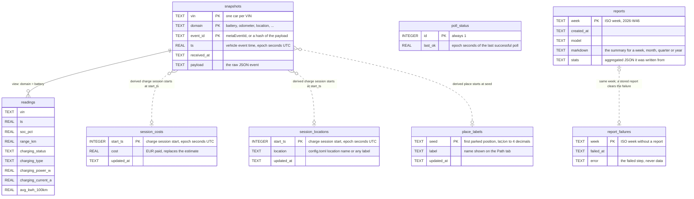

# Database

One SQLite file (`data/telemetry.db`, `/data/telemetry.db` in the containers), in WAL mode so the collector can write while the dashboard reads. The schema is the `SCHEMA` string in `polestar/collect.py`; `collect.connect()` creates anything missing with `CREATE ... IF NOT EXISTS`, so an existing database picks up a new table the next time it is opened.

Raw snapshots are the only record of the car. Trips, charge sessions, places, prices and the Path are **derived on read** and never stored.

Solid lines are real (the `readings` view selects from `snapshots`). Dotted lines are conventions kept by the code, not foreign keys: SQLite is not asked to enforce them.

## Tables

| Table | Written by | Holds |
|---|---|---|
| `snapshots` | collector (`collect.store`) | One row per telemetry event, the payload untouched. Deduplicated on `(vin, domain, event_id)`, so a poll that sees nothing new inserts nothing. Indexed on `(vin, domain, ts)`. |
| `poll_status` | collector (`collect_once`) | A single row: the time of the last poll that fetched data. Liveness comes from this, not from the newest event, because a parked car sends nothing for hours. |
| `reports` | `deploy/report.sh` (`report.store`, `report.store_grade`) | The Claude summaries, one per period id (`week` column: `2026-W47`, `2026-11`, `2026-Q4` or `2026`), the aggregates each was written from, and Claude's grade (`score` 1-10, `score_note`). No VIN or coordinates. |
| `report_failures` | the same script (`report.record_failure`) | A week whose report could not be written; shown as a warning on the Report tab until that week has a report. |
| `session_costs` | dashboard, behind the admin password (`costs.py`) | What you actually paid for a charge session, which replaces the tariff estimate. |
| `session_locations` | dashboard, behind the admin password (`costs.py`) | Where a charge session really was, which replaces the detected place: a `config.toml` location name (priced with its tariff and fee) or any other label (priced at the default price). |
| `place_labels` | dashboard, behind the admin password (`place_labels.py`) | A name for a place the Path tab grouped automatically. |

`readings` is a convenience view over the battery snapshots for ad-hoc SQL. The dashboard does not use it.

## Snapshot domains

`snapshots.domain` is one of the API domains in `polestar/client.py`:

- **Telemetry:** `battery`, `odometer`, `location`, `availability` (usage mode), `exterior`, `health`, `parkingClimatization`, `preCleaning` (cabin air).
- **Charging:** `targetSoc`, `ampLimit`, `globalChargeTimer`, `parkingClimateTimer`, plus `chargeLocations` and `isAtChargeLocation`, which return 404 for this car and so store nothing.

`derive.load(db, domain)` turns one domain's payloads into a DataFrame (nested keys flattened, `time` in UTC), which every derived view starts from.

## Keys that outlive the data

- **`session_costs.start_ts`** and **`session_locations.start_ts`** are the charge session's start as whole epoch seconds. Sessions are rebuilt from snapshots each time, so the start is the only stable identity they have. If a late event moved a session's start, its corrections would no longer match.
- **`place_labels.seed`** is the rounded position of a place's first reading. The automatic "Place 1", "Place 2" numbers move as history grows, but the first reading of a place never changes.

## Privacy

`snapshots` holds the VIN and, in `location` payloads, real positions. `place_labels.seed` holds rounded coordinates. Treat the file and its backups (`~/polestar-backups`) as personal data: never commit them, and see [Deployment](deployment.md#backups) for the nightly copies.
